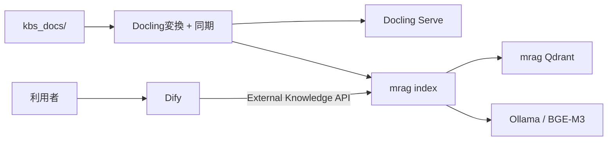

# mrag + Dify Docker RAG

[English](./README.md) · [セットアップRunbook](./SETUP-ja.md) · [インストール](./docs/installation-ja.md) · [運用](./docs/operations-ja.md) · [セキュリティ](./SECURITY-ja.md)

Difyとmragを接続する、セルフホスト型の日本語向けRAG基盤です。`kbs_docs/`へ文書を
配置すると、DoclingがMarkdownへ変換し、mragがindexを作成し、DifyからExternal
Knowledgeとして検索できます。

## 主な機能

- Dify、mrag、Docling Serve、Ollama、Qdrantを一つのDocker Compose構成で実行
- 定期実行と手動実行に対応した文書同期
- 追加、更新、改名、削除と大量削除guard
- sqlite-vaporettoによる日本語全文検索
- dense/keyword hybrid検索と日本語CrossEncoder reranker
- CPUおよびNVIDIA GPU profile
- Linux、macOS、Windowsネイティブ操作スクリプト
- 構造化ログ、dry-run、診断、バックアップ、復元

## 対応文書

| 形式 | 拡張子 | 処理 |
|---|---|---|
| PDF | `.pdf` | Doclingによるlayout、表、必要に応じたOCR変換 |
| Markdown | `.md` | 同じ取り込みpipelineで正規化 |
| テキスト | `.txt` | 正規化したMarkdownへ変換 |
| Word | `.docx` | Doclingで変換 |
| Excel | `.xlsx` | sheetと表をDoclingで変換 |
| PowerPoint | `.pptx` | slideをDoclingで変換 |
| 画像 | `.png`, `.jpg`, `.jpeg`, `.tif`, `.tiff`, `.bmp`, `.webp` | DoclingによるOCRとlayout変換 |

隠しファイル、symbolic link、未対応拡張子、一時ファイルは無視します。0 byteまたは
走査中に変更された原本は、不完全なindexを作らず同期を停止します。

## アーキテクチャ



Difyとmragは別々のQdrantを使用します。PostgreSQL、Redis、Qdrant、Ollama、Doclingは
ホストportへ公開しません。mrag OpenAPIは既定で`127.0.0.1`だけにbindします。

詳細は[アーキテクチャ](./docs/architecture-ja.md)を参照してください。

## 前提条件

- Docker EngineとDocker Compose v2
- ホスト操作用のGitとPython 3.11以降
- LinuxとmacOSでは`curl`
- 初回のimageおよびモデル取得に使うinternet接続
- Dify、Docling、選択したモデルに十分なmemoryとstorage

既定のDocling割当だけで8 CPU、12 GiB memoryを使用します。起動前に
[対応環境とサイジング](./docs/supported-platforms-ja.md)を確認してください。macOSでは
DockerからApple MetalをOllamaコンテナへ渡せないため、CPU profileを使用します。

## Quick Start

リポジトリルートで実行します。

```bash
./scripts/bootstrap-vendors.sh
if [[ -f .env ]]; then ./scripts/upgrade-env.sh; else ./scripts/init-env.sh; fi
./scripts/build.sh
./scripts/compose.sh config --quiet
./scripts/compose.sh up -d
./scripts/verify.sh
```

前提条件、GPU選択、port競合、初回downloadの再試行、正確な完了条件は、
[初回セットアップRunbook](./SETUP-ja.md)に従ってください。

Windowsネイティブでは対応する`.bat`を使用します。

```powershell
.\win-scripts\check-prerequisites.bat
.\win-scripts\bootstrap-vendors.bat
if (Test-Path .env) { .\win-scripts\upgrade-env.bat } else { .\win-scripts\init-env.bat }
.\win-scripts\build.bat
.\win-scripts\compose.bat config --quiet
.\win-scripts\compose.bat up -d
.\win-scripts\verify.bat
```

Difyは<http://localhost/install>で開きます。信頼できないnetworkから到達可能にする前に、
管理者初期設定を完了してください。mrag API仕様は
<http://localhost:8000/docs>で確認できます。

NVIDIA profileを含む全手順は[インストール](./docs/installation-ja.md)を参照してください。

## Difyとmragの接続

DifyのExternal Knowledgeへ次を登録します。

| 設定 | 値 |
|---|---|
| Endpoint | `http://mrag-api:8000` |
| API key | `.env`の`MRAG_API_KEY` |
| Knowledge ID | `main_kb` |

`/retrieval`はDifyが自動付加するため入力しません。回答生成にはDifyが対応する任意の
モデルを利用できます。GPT-5は選択肢の一つであり、必須ではありません。

## 文書の追加と同期

```bash
cp /absolute/path/to/document.pdf ./kbs_docs/
./scripts/sync-dry-run.sh
./scripts/sync-now.sh
```

既定では3時間ごとに同期します。同期は非blocking lockで保護され、index成功後だけ
同期manifestを確定します。

代表的な運用コマンド:

```bash
./scripts/docling-status.sh
./scripts/docling-doctor.sh
./scripts/mrag-doctor.sh
./scripts/reindex-now.sh
./scripts/reconvert-now.sh
```

削除guard、モデル管理、障害対応、バックアップ、復旧は
[運用手順](./docs/operations-ja.md)を参照してください。

## セキュリティとプライバシー

- `.env`には秘密値が含まれるため、Gitへ登録しないでください。
- Dify管理者作成とHTTPS設定より前に、新規環境をinternetへ公開しないでください。
- Ollama、Docling、PostgreSQL、Redis、二つのQdrantを外部公開しないでください。
- バックアップには秘密値と機密文書が含まれ得るため、暗号化とアクセス制限が必要です。
- 外部Dify model providerを選ぶと、質問と検索された文書断片がproviderへ送信される
  場合があります。

本番デプロイ前に[セキュリティ](./docs/security-ja.md)、
[プライバシー](./docs/privacy-ja.md)、[脆弱性報告方針](./SECURITY-ja.md)を確認してください。

## ドキュメント

- [初回セットアップRunbook](./SETUP-ja.md)
- [インストール](./docs/installation-ja.md)
- [対応環境とサイジング](./docs/supported-platforms-ja.md)
- [アーキテクチャ](./docs/architecture-ja.md)
- [運用手順](./docs/operations-ja.md)
- [バックアップと復元](./docs/backup-and-restore-ja.md)
- [セキュリティ](./docs/security-ja.md)
- [プライバシーとデータフロー](./docs/privacy-ja.md)
- [トラブルシューティング](./docs/troubleshooting-ja.md)
- [Docling取り込みコマンド](./docs/docling-ingestion-operations-ja.md)

## バージョン管理

本リポジトリはSemantic Versioningに従います。コンポーネントversion、source commit、
image digest、モデルrevision、成果物checksumの正本は[`VERSIONS`](./VERSIONS)です。

## ライセンス

本リポジトリの独自コードには[MIT License](./LICENSE)が適用されます。Dify、mrag、
Docling、Ollama、Qdrant、sqlite-vaporetto、機械学習モデル、その他の依存関係には
それぞれのライセンスが適用されます。特にDifyは標準Apache License 2.0ではなく、
マルチテナント運用とフロントエンドのbrandingに関する追加条件があります。

詳細は[サードパーティーライセンス](./THIRD_PARTY_NOTICES-ja.md)を参照してください。
