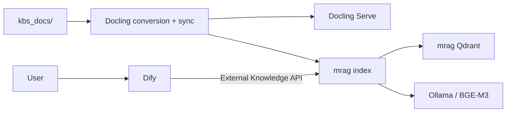

# mrag + Dify Docker RAG

[日本語](./README-ja.md) · [Setup runbook](./SETUP.md) · [Installation](./docs/installation.md) · [Operations](./docs/operations.md) · [Security](./SECURITY.md)

A self-hosted, Japanese-optimized Retrieval-Augmented Generation (RAG) stack
that connects Dify with mrag. Drop documents into `kbs_docs/`; Docling converts
them to Markdown, mrag indexes them, and Dify uses the index as External
Knowledge.

## Features

- One Docker Compose stack for Dify, mrag, Docling Serve, Ollama, and Qdrant
- Scheduled and on-demand document synchronization
- Safe add, update, rename, and delete handling with deletion guards
- Japanese full-text search with sqlite-vaporetto
- Hybrid dense/keyword retrieval and a Japanese cross-encoder reranker
- CPU and NVIDIA GPU profiles
- Linux, macOS, and native Windows launchers
- Structured logs, dry runs, diagnostics, backup, and restore tooling

## Supported documents

| Format | Extensions | Processing |
|---|---|---|
| PDF | `.pdf` | Layout, table, and optional OCR conversion with Docling |
| Markdown | `.md` | Normalized through the same ingestion pipeline |
| Plain text | `.txt` | Converted to normalized Markdown |
| Word | `.docx` | Converted with Docling |
| Excel | `.xlsx` | Sheets and tables converted with Docling |
| PowerPoint | `.pptx` | Slides converted with Docling |
| Images | `.png`, `.jpg`, `.jpeg`, `.tif`, `.tiff`, `.bmp`, `.webp` | OCR and layout conversion with Docling |

Hidden files, symbolic links, unsupported extensions, and temporary files are
ignored. A zero-byte or changing source file stops the scan rather than
silently producing an incomplete index.

## Architecture



Dify and mrag use separate Qdrant instances. PostgreSQL, Redis, Qdrant, Ollama,
and Docling are not published as host ports. The mrag OpenAPI endpoint binds to
`127.0.0.1` by default.

See [Architecture](./docs/architecture.md) for details.

## Requirements

- Docker Engine with Docker Compose v2
- Git and Python 3.11 or later on the host
- `curl` on Linux and macOS
- Internet access for the first image and model download
- Enough memory and storage for Dify, Docling, and the selected models

The default Docling allocation alone is 8 CPUs and 12 GiB of memory. Review
[Supported platforms and sizing](./docs/supported-platforms.md) before starting.
macOS uses the CPU profile because Docker cannot pass Apple Metal acceleration
to the Ollama container.

## Quick start

Run these commands from the repository root:

```bash
./scripts/bootstrap-vendors.sh
if [[ -f .env ]]; then ./scripts/upgrade-env.sh; else ./scripts/init-env.sh; fi
./scripts/build.sh
./scripts/compose.sh config --quiet
./scripts/compose.sh up -d
./scripts/verify.sh
```

For prerequisite checks, GPU selection, port conflicts, first-download retries,
and precise completion criteria, follow the [first-time setup runbook](./SETUP.md).

On native Windows, use the matching `.bat` commands:

```powershell
.\win-scripts\check-prerequisites.bat
.\win-scripts\bootstrap-vendors.bat
if (Test-Path .env) { .\win-scripts\upgrade-env.bat } else { .\win-scripts\init-env.bat }
.\win-scripts\build.bat
.\win-scripts\compose.bat config --quiet
.\win-scripts\compose.bat up -d
.\win-scripts\verify.bat
```

Open Dify at <http://localhost/install>. Complete the administrator setup before
making the service reachable from an untrusted network. The local mrag API
documentation is available at <http://localhost:8000/docs>.

For all installation options, including NVIDIA profiles, see
[Installation](./docs/installation.md).

## Connect Dify to mrag

Create an External Knowledge source in Dify with:

| Setting | Value |
|---|---|
| Endpoint | `http://mrag-api:8000` |
| API key | `MRAG_API_KEY` from `.env` |
| Knowledge ID | `main_kb` |

Do not append `/retrieval`; Dify adds it automatically. Any answer-generation
model supported by Dify can be used. GPT-5 is one option, not a requirement.

## Add and synchronize documents

```bash
cp /absolute/path/to/document.pdf ./kbs_docs/
./scripts/sync-dry-run.sh
./scripts/sync-now.sh
```

The default schedule runs every three hours. Synchronization is protected by a
non-blocking lock, and the index manifest is committed only after a successful
index operation.

Common commands:

```bash
./scripts/docling-status.sh
./scripts/docling-doctor.sh
./scripts/mrag-doctor.sh
./scripts/reindex-now.sh
./scripts/reconvert-now.sh
```

See [Operations](./docs/operations.md) for deletion guards, model management,
troubleshooting, backup, and recovery.

## Security and privacy

- `.env` contains credentials and must never be committed.
- Do not expose a fresh Dify installation to the internet before creating the
  administrator account and enabling HTTPS.
- Keep Ollama, Docling, PostgreSQL, Redis, and both Qdrant services private.
- Backups contain credentials and potentially confidential documents; encrypt
  them and restrict access.
- If an external Dify model provider is selected, the user's question and
  retrieved document excerpts may be sent to that provider.

Read [Security](./docs/security.md), [Privacy](./docs/privacy.md), and the
[security policy](./SECURITY.md) before a production deployment.

## Documentation

- [First-time setup runbook](./SETUP.md)
- [Installation](./docs/installation.md)
- [Supported platforms and sizing](./docs/supported-platforms.md)
- [Architecture](./docs/architecture.md)
- [Operations](./docs/operations.md)
- [Backup and restore](./docs/backup-and-restore.md)
- [Security](./docs/security.md)
- [Privacy and data flow](./docs/privacy.md)
- [Troubleshooting](./docs/troubleshooting.md)
- [Docling ingestion commands](./docs/docling-ingestion-operations.md)

## Versioning

This repository follows Semantic Versioning. Component versions, source
commits, image digests, model revisions, and artifact checksums are recorded in
[`VERSIONS`](./VERSIONS).

## License

Original code in this repository is licensed under the [MIT License](./LICENSE).
Dify, mrag, Docling, Ollama, Qdrant, sqlite-vaporetto, machine-learning models,
and other dependencies remain subject to their own licenses. In particular,
Dify uses a modified Apache License 2.0 with additional conditions for
multi-tenant operation and frontend branding.

See [Third-Party Notices](./THIRD_PARTY_NOTICES.md) for details.
