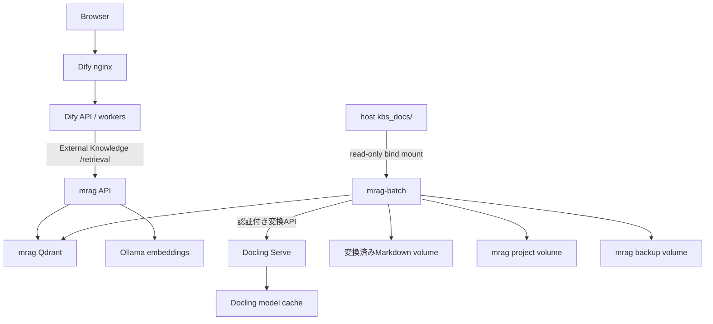

# アーキテクチャ

[English](./architecture.md)

## Requestと取り込み経路

原本文書はDifyへmountしません。batch serviceがCompose network内のDoclingへ送信し、
正規化したMarkdownを保存して、変換済み内容だけをmragへ渡します。

## Retrieval

mragはBGE-M3 dense vectorとsqlite-vaporetto日本語全文検索を組み合わせます。結果をfusionし、
設定した日本語CrossEncoderでrerankしてからDify External Knowledge APIへ返します。

## Vector databaseの分離

Difyとmragは別々のQdrant serviceとvolumeを使用します。mragはAPIと同期処理を安全に
並行実行するためQdrant server modeを使用します。

## 永続data

| Storage | 用途 |
|---|---|
| Dify PostgreSQL / storage volume | Dify user、workflow、会話、file |
| Dify Qdrant volume | Dify管理vector |
| `mrag_data` | mrag project databaseとmanifest |
| `mrag_qdrant_data` | mrag vector |
| `mrag_profiles/` | hostから編集するmrag profile |
| `mrag_converted_docs` | 正規化Markdownと変換manifest |
| `mrag_backups` | 変更前mrag backup |
| `ollama_models` | Ollama model |
| `mrag_model_cache` | Hugging Face reranker cache |
| `docling_model_cache` | Docling model cache |

## Network公開

- Dify nginx: 設定したhost port 80/443
- mrag API: 既定で`127.0.0.1:8000`とCompose内部接続
- PostgreSQL、Redis、二つのQdrant、Ollama、Docling: 内部のみ

Dify SSRF proxyのallowlistへ内部名`mrag-api`を設定します。mragをhost networkへ公開する
必要はありません。

## Sourceとimageの方針

Dify sourceを固定commitで取得し、公式Compose fileは編集しません。本プロジェクトの
serviceと有効image lockは追加Compose fileで適用します。mragは固定Git submoduleです。
project/component versionの機械可読な正本は`VERSIONS`です。

volumeはCompose project単位でscopedされるため、異なる`COMPOSE_PROJECT_NAME`を使う二つの
環境がmrag dataやmodel cacheを共有することはありません。
