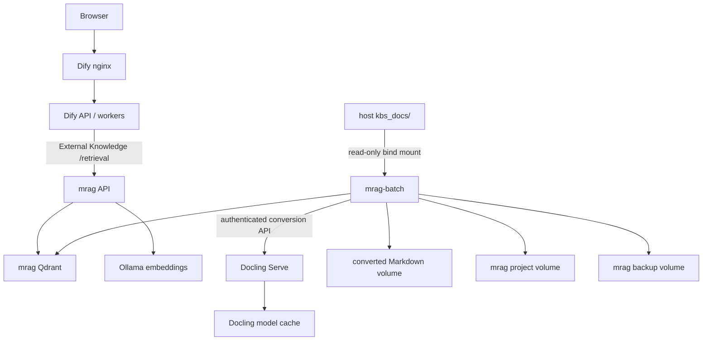

# Architecture

[日本語](./architecture-ja.md)

## Request and ingestion paths

Source documents are never mounted into Dify. The batch service sends them to
Docling inside the Compose network, stores normalized Markdown, and passes only
converted content to mrag.

## Retrieval

mrag combines BGE-M3 dense vectors with sqlite-vaporetto Japanese full-text
search. Results are fused and reranked with the configured Japanese cross-encoder
before being returned through Dify's External Knowledge API.

## Separate vector databases

Dify and mrag have separate Qdrant services and volumes. mrag uses Qdrant server
mode so the API and synchronization job can safely work concurrently.

## Persistent data

| Storage | Purpose |
|---|---|
| Dify PostgreSQL and storage volumes | Dify users, workflows, conversations, and files |
| Dify Qdrant volume | Dify-managed vectors |
| `mrag_data` | mrag project database and manifests |
| `mrag_qdrant_data` | mrag vectors |
| `mrag_profiles/` | Host-editable mrag profiles |
| `mrag_converted_docs` | Normalized Markdown and conversion manifest |
| `mrag_backups` | Pre-change mrag backups |
| `ollama_models` | Ollama models |
| `mrag_model_cache` | Hugging Face reranker cache |
| `docling_model_cache` | Docling model cache |

## Network exposure

- Dify nginx: host ports 80/443 as configured.
- mrag API: `127.0.0.1:8000` by default, plus internal Compose access.
- PostgreSQL, Redis, both Qdrant services, Ollama, and Docling: internal only.

Dify's SSRF proxy allowlist permits the internal `mrag-api` name. It does not
require opening mrag to the host network.

## Source and image policy

Dify source is downloaded at a pinned commit and its official Compose file is
not edited. Project-specific services and active image locks are applied through
additional Compose files. mrag is a pinned Git submodule. `VERSIONS` is the
machine-readable source of truth for project and component versions.

Project volumes are Compose-project scoped, so two installations with different
`COMPOSE_PROJECT_NAME` values do not share mrag data or model caches.
